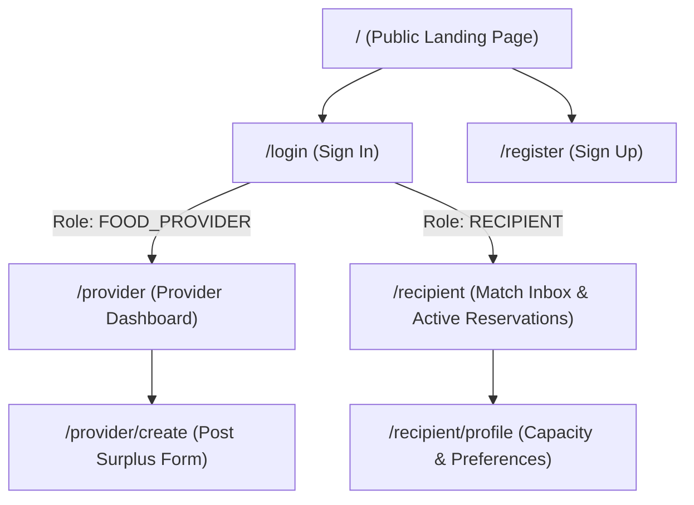

# Atharva's Frontend Developer Guide — FoodSync AI

> **Status**: Architecture Frozen — Authoritative Handbook for Frontend Development  
> **Target Audience**: Atharva (Frontend Developer)  
> **Assigned Working Branch**: `feature/frontend`  
> **Primary Role**: Frontend Developer (Next.js App Router, TypeScript, Tailwind CSS, API Integration, Client State)  
> **Primary Repository Codebase Area**: `frontend/`  
> **Repository**: [KShruti772/FoodSync-AI](https://github.com/KShruti772/FoodSync-AI)

---

## 🌟 Core Team Principle

> **"Atharva brings FoodSync AI to life in the browser. He implements the production Next.js web application, TypeScript components, Tailwind CSS styling, client-side state, and REST API communication based on Vishwajeet's UI/UX specifications. Vishwajeet leads UI/UX design specifications, wireframes, and QA testing across all test suites. Shubham implements the FastAPI backend, API routes, and domain services. Lokeshwari builds the database models, repositories, and migrations. Shruti leads the team, system architecture, and the deterministic matching engine."**

---

## 👥 Final Team Ownership Model

| Teammate | Role | Assigned Branch | Scope & Owned Directories |
| :--- | :--- | :--- | :--- |
| **Shruti** | **Team Lead / AI / Architecture** | `feature/ai-matching` | `backend/app/services/matching/` *(Matching Algorithm & Scoring Logic)*<br>System Architecture, Project Lead, Cross-Layer Coordination |
| **Shubham** | **Backend Developer** | `feature/backend` | `backend/app/api/`<br>`backend/app/core/`<br>`backend/app/schemas/`<br>`backend/app/services/` *(Domain Services except matching engine)*<br>`backend/app/utils/`<br>`backend/app/main.py` |
| **Atharva** | **Frontend Developer** | `feature/frontend` | `frontend/app/`<br>`frontend/components/`<br>`frontend/hooks/`<br>`frontend/lib/`<br>`frontend/services/`<br>`frontend/types/`<br>*(Next.js App Router, TypeScript & Tailwind CSS)* |
| **Lokeshwari** | **Database Developer** | `feature/database` | `backend/app/models/`<br>`backend/app/repositories/`<br>`backend/alembic/`<br>*(PostgreSQL Schema, SQLAlchemy 2.x Models & Migrations)* |
| **Vishwajeet** | **UI/UX + Testing / QA Lead** | `feature/ui-testing` | `frontend/components/__tests__/` *(Component UI Tests)*<br>`backend/tests/` *(Backend Unit & Integration Tests)*<br>`tests/e2e/` *(Playwright Browser E2E Tests)*<br>`docs/` *(UI/UX Specs, Test Matrices & User Flows)* |

---

# SECTION 1 — Welcome & Role Definition

Welcome to the **FoodSync AI** engineering team, Atharva!

As the **Frontend Developer**, you own the entire user-facing web client. You transform wireframes, user journeys, and REST API contracts into an intuitive, responsive, accessible, and fast web application.

### Your High-Level Responsibilities:
1. **Next.js App Router**: Build structured pages and layouts for Food Providers and Recipients in `frontend/app/`.
2. **Modular UI Components**: Construct reusable, accessible React components in `frontend/components/` using Tailwind CSS.
3. **TypeScript API Interfaces**: Maintain strict TypeScript API and domain types in `frontend/types/` aligned with the approved API contract ([`docs/API_CONTRACT.md`](file:///Users/shrutikondabathula/FoodSync-AI/docs/API_CONTRACT.md)).
4. **API Integration & Client Services**: Implement HTTP communication in `frontend/services/` using the approved backend API contract.
5. **Client State & Session Management**: Manage client session state, authentication behavior, and periodic notification refresh according to the approved architecture.
6. **UI Feedback States**: Implement the applicable mandatory UI states: Loading, Empty, Success, Error, Disabled, Unauthorized.
7. **Privacy UX Compliance**: Render only information authorized and returned by the backend.

---

# SECTION 2 — Frontend vs. UI/UX

To ensure seamless teamwork between Atharva and Vishwajeet, understand this separation of responsibilities:

```text
┌─────────────────────────────────────────────────────────────┐
│ VISHWAJEET (UI/UX Design & QA)                              │
│ • Defines what the user sees, feels, and experiences.       │
│ • Creates user flows, wireframes, and screen requirements.  │
│ • Defines accessibility rules (WCAG 2.1 AA) and states.     │
│ • Writes test cases and tests Atharva's built UI.           │
├─────────────────────────────────────────────────────────────┤
│ ATHARVA (Frontend Implementation)                           │
│ • Writes the production Next.js, React, and TypeScript code.│
│ • Styles components using Tailwind CSS utility classes.     │
│ • Connects buttons and forms to FastAPI REST endpoints.     │
│ • Manages client-side session state and authentication      │
│   behavior according to the approved authentication         │
│   transport and storage mechanism.                          │
│ • Resolves frontend bugs reported by Vishwajeet.            │
└─────────────────────────────────────────────────────────────┘
```

### Practical Example:
- **Vishwajeet specifies**: *"The Match Decision Modal must display the compatibility percentage, show a loading spinner on submit, disable double-clicks, and keep the street address hidden until accepted."*
- **Atharva implements**: Atharva writes `MatchActionModal.tsx`, binds TypeScript props, calls `matchService.acceptMatch(matchId)`, renders `LoadingSkeleton`, and handles error toasts.

---

# SECTION 3 — What You Own

Atharva has primary implementation ownership over the planned `frontend/` directory structure:

```text
frontend/
├── app/
│   ├── layout.tsx
│   ├── page.tsx
│   ├── login/
│   │   └── page.tsx
│   ├── register/
│   │   └── page.tsx
│   ├── provider/
│   │   ├── page.tsx
│   │   └── create/
│   │       └── page.tsx
│   └── recipient/
│       ├── page.tsx
│       └── profile/
│           └── page.tsx
│
├── components/
│   ├── common/
│   ├── navigation/
│   └── domain/
│
├── hooks/
│   ├── useAuth.ts
│   └── useNotifications.ts
│
├── lib/
│   ├── utils.ts
│   └── formatters.ts
│
├── services/
│   ├── apiClient.ts
│   ├── authService.ts
│   ├── donationService.ts
│   ├── matchService.ts
│   ├── notificationService.ts
│   └── impactService.ts
│
└── types/
```

---

# SECTION 4 — What You Do NOT Own & Strict Boundary Rules

| Area / Directory | Primary Owner | Why Atharva Does NOT Own It |
|---|---|---|
| `backend/app/api/`, `backend/app/core/`, `backend/app/schemas/`, `backend/app/services/` except matching, `backend/app/utils/`, `backend/app/main.py` | **Shubham** (`feature/backend`) | Backend API controllers, business logic, schemas, and security infrastructure. |
| `backend/app/services/matching/` | **Shruti** (`feature/ai-matching`) | Deterministic matching algorithm and scoring weights. |
| `backend/app/models/`, `backend/app/repositories/`, `backend/alembic/` | **Lokeshwari** (`feature/database`) | PostgreSQL models, repositories, constraints, and migrations. |
| `frontend/components/__tests__/`, `backend/tests/`, `tests/e2e/` | **Vishwajeet** (`feature/ui-testing`) | Vishwajeet owns test-suite authoring and QA. Atharva fixes frontend defects discovered by QA. |

> [!IMPORTANT]
> **Strict Team Boundary Rule**: Atharva must not modify another teammate's implementation area to bypass ownership boundaries. Changes outside `frontend/` require direct coordination with the relevant owner.

---

# SECTION 5 — Frontend Basics

| Concept | Plain-English Definition | FoodSync AI Example |
|---|---|---|
| **Frontend** | The application users interact with in their browser. | FoodSync AI web portal. |
| **Next.js** | React framework used for routing, rendering, and application structure. | `/provider/create` page. |
| **React** | Library for building reusable user-interface components. | `DonationCard`. |
| **TypeScript** | JavaScript with static type checking. | Ensuring `quantity_meals` has the expected type. |
| **Tailwind CSS** | Utility-first CSS framework. | Responsive styling with utility classes. |
| **Component** | Reusable UI building block. | `Button`, `InputField`, `MatchCard`. |
| **Page** | Component associated with an application route. | `frontend/app/provider/page.tsx`. |
| **Hook** | React function for reusable state or side-effect logic. | `useAuth()`. |
| **Client State** | Temporary UI/session information managed by the browser. | Modal state or current session presentation. |
| **API Client** | Code that sends HTTP requests to the backend. | Calling `/api/v1/matches/{id}/accept`. |
| **JSON** | Structured text format used for API requests/responses. | User profile or donation response. |

---

# SECTION 6 — Frontend Technology Stack & Design Tokens

FoodSync AI adheres to the frozen design tokens specified in [`docs/UI_GUIDELINES.md`](file:///Users/shrutikondabathula/FoodSync-AI/docs/UI_GUIDELINES.md):

```text
┌─────────────────────────────────────────────────────────────┐
│ Web Framework        : Next.js 14+ (App Router)              │
├─────────────────────────────────────────────────────────────┤
│ UI Library           : React 18+                             │
├─────────────────────────────────────────────────────────────┤
│ Type Safety          : TypeScript 5+ (Strict Mode)           │
├─────────────────────────────────────────────────────────────┤
│ Styling System       : Tailwind CSS 3+                       │
├─────────────────────────────────────────────────────────────┤
│ Icons Library        : Lucide React (SVG Icons)              │
├─────────────────────────────────────────────────────────────┤
│ HTTP Communication   : Native Fetch API with Custom Client   │
└─────────────────────────────────────────────────────────────┘
```

### Design System Color Tokens:
- **Brand Primary**: Emerald (`#10B981` / `bg-emerald-500`, hover: `#059669` / `hover:bg-emerald-600`)
- **Secondary Accent**: Teal (`#0D9488` / `bg-teal-600`)
- **Background Light**: Slate-50 (`#F8FAFC` / `bg-slate-50`)
- **Card Surface**: Pure White (`#FFFFFF` / `bg-white`, border: `#E2E8F0` / `border-slate-200`)
- **Status Badges**:
  - `AVAILABLE`: Sky / Blue (`bg-sky-100 text-sky-800`)
  - `RESERVED`: Amber / Yellow (`bg-amber-100 text-amber-800`)
  - `COMPLETED`: Emerald / Green (`bg-emerald-100 text-emerald-800`)
  - `CANCELLED` / `EXPIRED`: Slate (`bg-slate-100 text-slate-700`)

---

# SECTION 7 — Component Architecture

Atharva organizes components into three clean tiers of planned and approved components:

### 1. Common Primitives (`frontend/components/common/`)
- `Button.tsx`: Variants (`primary`, `secondary`, `outline`, `danger`) with loading spinner state.
- `InputField.tsx`: Accessible input wrapping label, validation helper text, and error styles.
- `SelectDropdown.tsx`: Dropdown for roles, food types, and dietary preferences.
- `StatusBadge.tsx`: Color-coded pill tag for donation and match statuses.
- `Modal.tsx`: Accessible dialog overlay with backdrop and `Escape` key trigger.
- `LoadingSkeleton.tsx`: Animated pulse skeleton cards for data fetching states.
- `EmptyState.tsx`: Illustrated placeholder for zero-item lists.

### 2. Navigation Elements (`frontend/components/navigation/`)
- `Navbar.tsx`: Header containing brand logo, user role badge, and notification indicator.
- `Sidebar.tsx`: Mobile and desktop responsive navigation menu.
- `NotificationBell.tsx`: Dropdown feed displaying polled alerts.

### 3. Domain Business Widgets (`frontend/components/domain/`)
- `DonationCard.tsx`: Summary card rendering surplus listings with masked address.
- `MatchCard.tsx`: Recipient card rendering compatibility score breakdown.
- `MatchActionModal.tsx`: Modal for accepting or rejecting a proposed match. *(Always use `MatchActionModal`, never `ClaimActionModal`).*
- `ImpactWidget.tsx`: Stat cards showing rescued meals and estimated $\text{CO}_2$ saved.

---

# SECTION 8 — Pages & Application Routing



> [!IMPORTANT]
> **No Admin Web Screens in MVP**: `ADMIN` may exist as a backend authorization role, but the MVP contains no Admin web dashboard and no `/admin` frontend route. Administrator accounts are provisioned via backend deployment CLI. Do not invent unapproved `/admin` web routes or navigation items.

---

# SECTION 9 — Custom React Hooks

### 1. `useAuth.ts`
Manages client-side session state and interaction with the backend authentication API:
- Interacts with `POST /api/v1/auth/login`, `POST /api/v1/auth/register`, and `GET /api/v1/auth/me`.
- Manages the client-side session token according to the approved API transport contract.
- Provides current user session data (`id`, `email`, `role`, `organization_name`, `is_verified`).
- **Authorization Boundary Reminder**: `useAuth` is strictly for frontend session presentation. The FastAPI backend remains the sole authority for JWT validation, role authorization, and resource ownership.

```ts
// Conceptual structure of useAuth:
export interface AuthContextType {
  user: UserProfile | null;
  login: (credentials: LoginCredentials) => Promise<void>;
  logout: () => void;
  isAuthenticated: boolean;
  role: 'FOOD_PROVIDER' | 'RECIPIENT' | 'ADMIN' | null;
}
```

### 2. `useNotifications.ts`
Polls the backend REST endpoint (`GET /api/v1/notifications`) every 30 seconds for periodic notification refresh:
- Acts strictly as a frontend periodic refresh mechanism; the backend remains the source of truth.
- Tracks unread count for `NotificationBell` and provides `markAsRead(notificationId)` calling `PATCH /api/v1/notifications/{id}/read`.
- **Implementation Safety Note**: The polling interval timer must be cleanly cleared on component unmount to prevent memory leaks and duplicate background timers.
- Handles loading, empty, and error feedback states gracefully.

---

# SECTION 10 — API Client & Communication

The frontend communicates with FastAPI exclusively over HTTP REST. **There is zero direct connection to PostgreSQL.**

### API Base URL & Path Convention:
- **Origin Only**: `NEXT_PUBLIC_API_URL` contains only the backend origin (`http://localhost:8000`).
- **Endpoint Prefix**: All API service calls explicitly specify `/api/v1/...` (e.g. `/api/v1/auth/login`, `/api/v1/donations`, `/api/v1/matches/{id}/accept`).
- **Safety Guarantee**: Combining `NEXT_PUBLIC_API_URL` (`http://localhost:8000`) with `/api/v1/...` guarantees clean URLs (`http://localhost:8000/api/v1/...`) and prevents double-prefix errors (`/api/v1/api/v1/...`).

### Conceptual API Client Usage:
```ts
// NEXT_PUBLIC_API_URL contains the backend origin only.
// Example: http://localhost:8000

const BASE_URL =
  process.env.NEXT_PUBLIC_API_URL || 'http://localhost:8000';

// Service methods provide the complete /api/v1/... endpoint.
apiRequest('/api/v1/matches/42/accept', {
  method: 'POST',
});
```

> [!IMPORTANT]
> **API Contract Authority**: [`docs/API_CONTRACT.md`](file:///Users/shrutikondabathula/FoodSync-AI/docs/API_CONTRACT.md) is the authoritative contract between frontend and backend. Atharva must not invent endpoints, request fields, response fields, or undocumented status codes. If the frontend and API contract disagree, do not silently adapt the frontend; coordinate with Shubham to update the contract through the agreed team process.

---

# SECTION 11 — Authentication & Security

### 1. MVP Authentication:
The backend uses signed JWT access tokens for authenticated API requests, as defined by [`docs/API_CONTRACT.md`](file:///Users/shrutikondabathula/FoodSync-AI/docs/API_CONTRACT.md).

The frontend attaches the approved authentication credential to authenticated requests according to the transport mechanism defined in `docs/API_CONTRACT.md`.

The frontend must use the authentication transport and browser storage mechanism agreed between frontend and backend and documented in `docs/API_CONTRACT.md`.

Atharva must not independently invent or change the authentication transport or storage mechanism.

### 2. Frontend is NOT the Security Boundary:
The backend independently enforces JWT validation, RBAC permissions, resource ownership, and donation state transitions on every API request.

Never trust client-supplied user IDs, roles, donation statuses, or match states.

Atharva uses client role checks strictly to provide a smooth user experience (e.g. redirecting a Recipient away from `/provider/create`).

### 3. No Secrets in Frontend:
Never commit passwords, API secret keys, JWT secret keys, or database credentials to frontend code.

`NEXT_PUBLIC_*` environment variables are baked into public browser JavaScript bundles and must **never** contain private secrets.

Never commit `.env` or `.env.local` files to Git.

---

# SECTION 12 — Match Status vs. Donation Status Lifecycle Distinction

Atharva must strictly distinguish between **Match Status** and **Donation Status** in components and state management:

| Entity | Permitted States | Important Transitions |
|---|---|---|
| Match | `PROPOSED`, `ACCEPTED`, `REJECTED` | `PROPOSED` $\rightarrow$ `ACCEPTED` or `PROPOSED` $\rightarrow$ `REJECTED` |
| Donation | `AVAILABLE`, `RESERVED`, `COMPLETED`, `EXPIRED`, `CANCELLED` | `AVAILABLE` $\rightarrow$ `RESERVED` $\rightarrow$ `COMPLETED`, plus documented expiry/cancellation transitions |

> [!CAUTION]
> **NO `CLAIMED` STATE / NO `/claim` ROUTE**: Do not implement a CLAIMED donation state, `/claim` route, `ClaimActionModal`, or claim-based donation lifecycle. The donation lifecycle strictly uses `AVAILABLE` $\rightarrow$ `RESERVED` $\rightarrow$ `COMPLETED`, with the documented expiry and cancellation transitions.

- **When a Recipient Accepts a Match (`POST /api/v1/matches/{id}/accept`)**:
  1. Match status transitions to `ACCEPTED`.
  2. Donation status transitions to `RESERVED`.
  3. Authorized full pickup address and provider contact information become available in the active coordination view.
- **When a Recipient Rejects a Match (`POST /api/v1/matches/{id}/reject`)**:
  1. Match status transitions to `REJECTED`.
  2. Donation remains `AVAILABLE` for the next eligible candidate.
  3. Protected pickup details remain hidden.

---

# SECTION 13 — The Applicable Mandatory UI States

Every API-driven or interactive view must implement the applicable mandatory UI states:

| UI State | Implementation Requirement |
|---|---|
| **Loading** | Show appropriate loading feedback such as `LoadingSkeleton`. Do not leave a blank screen. |
| **Empty** | Show `EmptyState` with useful guidance or CTA where applicable. |
| **Error** | Show a clear user-friendly error and retry action where applicable. Never expose raw JSON or stack traces. |
| **Success** | Show returned data and appropriate status feedback. |
| **Disabled** | Disable in-flight actions and prevent duplicate submissions. |
| **Unauthorized** | Redirect or show an appropriate authorization message. |

---

# SECTION 14 — Location Privacy UX & Address Reveal Invariant

> [!CAUTION]
> **Data Privacy Invariant**: CSS hiding is NOT security. The frontend must only render what the backend authorizes and returns.

| Stage | Information Visible |
|---|---|
| Before authorized acceptance | City/neighborhood or approximate area and approximate distance |
| Before authorized acceptance | Exact street address hidden |
| Before authorized acceptance | Provider contact information hidden |
| After authorized acceptance | Exact pickup address may be displayed if returned by backend |
| After authorized acceptance | Authorized provider contact information may be displayed |
| After authorized acceptance | Pickup/handling instructions may be displayed if authorized |

- **Before Authorized Match Acceptance**: Display only approximate area and distance.
- **After Authorized Match Acceptance**: When `POST /api/v1/matches/{id}/accept` succeeds and returns unlocked pickup details, render full address and provider contact information.
- **Privacy Rule**: The frontend must **never** attempt to reconstruct, infer, derive, or expose protected location or contact information from other API fields.

---

# SECTION 15 — Matching UI & Deterministic Explainability

The MVP matching engine is deterministic and explainable. It is a mathematical multi-factor heuristic ranking algorithm, not machine learning, an LLM, or AI prediction.

The deterministic matching engine uses these configured weights:
- **Distance** = `0.35`
- **Urgency** = `0.30`
- **Capacity** = `0.20`
- **Requirement** = `0.15`

> **Frontend Matching Rule**: The frontend displays the authoritative compatibility score and matched-factor values returned by the backend/API contract. It must **not** independently recompute, modify, or invent matching weights on the client.

### Atharva's Match UI Implementation:
1. **Compatibility Badge**: Render the score percentage returned by the backend (e.g., `"92% Compatibility"`).
2. **Score Factor Breakdown**: Display explanatory factor information from `matched_factors` according to the approved API response schema in [`docs/API_CONTRACT.md`](file:///Users/shrutikondabathula/FoodSync-AI/docs/API_CONTRACT.md):
   - **Distance**: `"2.4 km away (Within travel radius)"` (`distance_score`)
   - **Urgency**: `"Expires in 3 hours"` (`urgency_score`)
   - **Capacity**: `"50 meals (Fits your daily capacity of 100)"` (`capacity_fit_score`)
   - **Dietary**: `"Vegetarian matches your preference"` (`dietary_preference_score`)
3. **Decision Actions**: Provide clear **"Accept Match"** and **"Decline"** buttons.

---

# SECTION 16 — Impact Metrics Integration

The public landing page and dashboards display aggregate impact statistics fetched directly from `GET /api/v1/impact/summary` ([`docs/API_CONTRACT.md`](file:///Users/shrutikondabathula/FoodSync-AI/docs/API_CONTRACT.md)):
- `total_meals_rescued`: Total aggregate meals rescued.
- `total_food_weight_kg`: Total food weight in kg.
- `total_co2_offset_kg`: Estimated carbon emissions saved.
- `active_providers_count`: Number of active food providers.
- `active_recipients_count`: Number of active recipient organizations.

> **Contract Rule**: The frontend displays backend-provided values from the approved impact endpoint. The frontend does not invent calculation formulas or perform independent client-side impact calculations.

---

# SECTION 17 — Accessibility & Mobile Responsiveness

- **WCAG 2.1 AA Compliance**: Ensure a minimum contrast ratio of 4.5:1 for normal body text against its background (`text-slate-900` on `bg-white`).
- **Keyboard Navigation**:
  - `Tab`: Sequential focus navigation with visible focus indicators.
  - `Enter` / `Space`: Appropriate activation for buttons and interactive controls.
  - `Escape`: Dismissible dialogs and modals.
  - `Arrow Keys`: Use where the selected/custom interactive component requires them.
  - Prefer native accessible HTML controls where appropriate instead of unnecessarily recreating browser keyboard behavior manually.
- **Form Labels**: Every input must have an associated `<label>` or an appropriate accessible name such as `aria-label` where required.
- **Mobile-First Layout**: Use responsive Tailwind prefixes adapting across:
  - Mobile: 375px+
  - Tablet: 768px+
  - Desktop: 1440px+

---

# SECTION 18 — Testing Collaboration with Vishwajeet

**Vishwajeet** (`feature/ui-testing`) is the primary owner and author of test suites:
- `frontend/components/__tests__/` (Vitest Component UI Tests)
- `backend/tests/` (Pytest Unit & Integration Tests)
- `tests/e2e/` (Playwright Browser Journey Tests)

### How Atharva Cooperates with Vishwajeet:
1. **Build to Spec**: Atharva implements components based on Vishwajeet's wireframes and UI checklists.
2. **QA Review**: Vishwajeet tests the UI across viewports, error states, and accessibility.
3. **Defect Resolution**: When Vishwajeet reports a bug (e.g. form submit button doesn't disable during loading), Atharva resolves the issue on `feature/frontend`.
4. **Retesting**: Vishwajeet retests and verifies regression.

---

# SECTION 19 — Working with Shubham

- **API Contracts**: Coordinate with Shubham on request payload shapes and response keys defined in [`docs/API_CONTRACT.md`](file:///Users/shrutikondabathula/FoodSync-AI/docs/API_CONTRACT.md).
- **HTTP Status Codes**: Ensure frontend handles backend error codes correctly (`400`, `401`, `403`, `404`, `409 Conflict`, `422 Unprocessable Entity`) without displaying raw stack traces.
- **Mock Data**: While Shubham implements endpoints, Atharva can use mock TypeScript fixtures conforming strictly to `docs/API_CONTRACT.md` to build UI components without blocking. Mock data is for development/testing only and must not become an unofficial API specification or a source of invented fields.

---

# SECTION 20 — Working with Shruti

- **System Architecture**: Contact Shruti for high-level architectural decisions, scope adjustments, and cross-layer coordination.
- **Matching Display Logic**: Confirm the exact matching-factor structure with Shruti and Shubham before implementing detailed score breakdowns.

---

# SECTION 21 — Git Workflow for feature/frontend

Atharva works strictly on `feature/frontend` and normally modifies only files under `frontend/`. If a change outside `frontend/` is required, coordinate with the relevant owner before modifying it. **Never commit or push directly to `main`**.

### Daily Step-by-Step Git Commands:

```bash
# 1. Start of day
git status

# 2. Update main
git switch main
git pull origin main

# 3. Update frontend branch
git switch feature/frontend
git merge main

# 4. Implement frontend changes

# 5. Validate when project scripts are initialized
npm run lint
npx tsc --noEmit

# 6. Review changes
git status
git diff

# 7. Commit
# Stage only the files intentionally changed for the task. Review git status and git diff before committing.
git add <intended files>
git commit -m "feat(provider): implement surplus donation creation form"

# 8. Push feature branch
git push origin feature/frontend

# 9. Open Pull Request
# feature/frontend -> main
```

### Strict Git Rules:
- ❌ **NO `git push --force`** on any branch.
- ❌ **NO `git reset --hard`** on shared integration points.
- ❌ **NO direct pushes to `main`**.
- ❌ **NO committing `.env` files, passwords, or secret tokens**.
- ❌ **NO editing other teammates' active branches to bypass ownership**.

---

# SECTION 22 — First-Day Checklist

1. Clone repository and checkout `feature/frontend`.
2. Pull latest changes from `main`.
3. Read [`docs/PROJECT_OVERVIEW.md`](file:///Users/shrutikondabathula/FoodSync-AI/docs/PROJECT_OVERVIEW.md) and [`docs/ARCHITECTURE.md`](file:///Users/shrutikondabathula/FoodSync-AI/docs/ARCHITECTURE.md).
4. Read [`docs/UI_GUIDELINES.md`](file:///Users/shrutikondabathula/FoodSync-AI/docs/UI_GUIDELINES.md) and [`docs/SECURITY_GUIDELINES.md`](file:///Users/shrutikondabathula/FoodSync-AI/docs/SECURITY_GUIDELINES.md).
5. Review [`docs/API_CONTRACT.md`](file:///Users/shrutikondabathula/FoodSync-AI/docs/API_CONTRACT.md).
6. Inspect planned/current frontend structure.
7. Configure: `NEXT_PUBLIC_API_URL=http://localhost:8000` in `.env.local`.
8. Do not modify backend, database, or test ownership areas without explicit coordination.

---

# SECTION 23 — Common Beginner Frontend Mistakes

1. ❌ **Relying on client-side authorization**: Always assume any user can inspect JavaScript; the backend must enforce all permissions.
2. ❌ **Direct database access**: Never attempt to connect directly to PostgreSQL from Next.js.
3. ❌ **Implementing the prohibited CLAIMED lifecycle**: Do not implement a CLAIMED donation state, `/claim` route, `ClaimActionModal`, or claim-based donation lifecycle. The donation lifecycle strictly uses `AVAILABLE` $\rightarrow$ `RESERVED` $\rightarrow$ `COMPLETED`, with the documented expiry and cancellation transitions.
4. ❌ **Double-prefixing API URLs**: Configure `NEXT_PUBLIC_API_URL=http://localhost:8000` and pass `/api/v1/...` in service calls.
5. ❌ **Missing Loading/Empty States**: Never render a blank white screen during API fetch; always use `LoadingSkeleton` and `EmptyState`.
6. ❌ **Leaking private addresses in client state**: Never store or render unmasked pickup addresses before authorized acceptance.
7. ❌ **Recomputing matching scores on the client**: Always render the authoritative score returned by the backend.
8. ❌ **Modifying non-frontend directories**: Coordinate with Shubham, Lokeshwari, or Vishwajeet instead of editing backend/database/test files.

---

# SECTION 24 — Quick Reference & Commands

### Planned Next.js Development Commands (When initialized):
```bash
# Start local Next.js development server:
npm run dev

# Run TypeScript type checker:
npx tsc --noEmit

# Run ESLint validation:
npm run lint
```

### Core Frontend Route Reference:
- `/` $\rightarrow$ Public landing page with impact metrics.
- `/login` $\rightarrow$ User sign-in.
- `/register` $\rightarrow$ Food Provider & Recipient registration.
- `/provider` $\rightarrow$ Food Provider active listings dashboard.
- `/provider/create` $\rightarrow$ Surplus donation creation form.
- `/recipient` $\rightarrow$ Recipient match inbox & active reservations.
- `/recipient/profile` $\rightarrow$ Daily capacity & dietary preferences configuration.

---

# SECTION 25 — Questions & Escalation Guide

```text
Have a UI/UX layout, wireframe, or accessibility question?
      ↓
Contact VISHWAJEET (feature/ui-testing)

Have a frontend React / Next.js / Tailwind implementation question?
      ↓
You own it! Check docs/UI_GUIDELINES.md and build it.

Have an API endpoint, request/response, or auth token question?
      ↓
Contact SHUBHAM (feature/backend)

Have a deterministic matching scoring formula or AI architecture question?
      ↓
Contact SHRUTI (feature/ai-matching)

Have a database model, schema constraint, or migration question?
      ↓
Contact LOKESHWARI (feature/database)

Have a test failure or component QA test question?
      ↓
Contact VISHWAJEET (feature/ui-testing)
```
