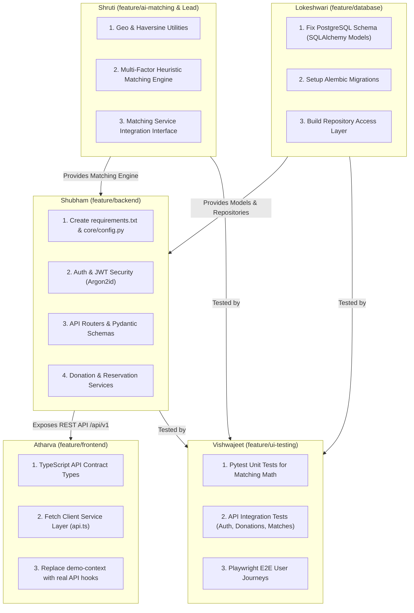

# FoodSync AI — Implementation Audit and Readiness Report

> **Date of Audit**: October 12, 2026  
> **Auditor**: Senior Full-Stack & Systems Architecture Reviewer  
> **Repository**: [KShruti772/FoodSync-AI](https://github.com/KShruti772/FoodSync-AI)  
> **Target Branch**: `main` (commit `c95e375`)  
> **Scope**: Complete Full-Stack Repository Audit (Frontend, Backend, Database, AI Matching, Security, Testing, Architecture)

---

## A. Executive Summary

FoodSync AI is currently a **Frontend Prototype with Architectural Documentation and an Incomplete Database Dump**. It is **not** an operational MVP and is **not** full-stack ready.

### Current System Reality
1. **Frontend (`frontend/`)**: **Polished Client-Side Interactive Prototype (90% UI complete, 0% API connected)**. Built with Next.js 14 (App Router), React 18, TypeScript, and Tailwind CSS. All 15 routes render cleanly, pass production compilation (`next build`), and demonstrate interactive user journeys (Provider surplus creation, Recipient match review, privacy reveal, and in-app notifications). However, this entire application runs purely on client-side state (`frontend/lib/demo-context.tsx`) backed by `localStorage` and synthetic data (`frontend/lib/demo-data.ts`). It makes **zero network requests** to `/api/v1` and contains no API client integration layer.
2. **Backend (`backend/app/`)**: **Unimplemented Scaffolding (1% complete)**. The only backend code in the repository is a 14-line FastAPI initialization file (`backend/app/main.py`) which mounts no routes, middleware, or database handlers. All directories for routers (`backend/app/api/v1/`), configuration (`backend/app/core/`), validation schemas (`backend/app/schemas/`), domain services (`backend/app/services/`), repositories (`backend/app/repositories/`), ORM models (`backend/app/models/`), and utilities (`backend/app/utils/`) contain only `.gitkeep` placeholder files. There is no `requirements.txt` or `pyproject.toml` file in the repository.
3. **AI Matching Engine (`backend/app/services/matching/`)**: **Completely Unimplemented (0% complete)**. While comprehensively specified across `docs/AI_MATCHING.md` and `docs/SHRUTI_DEVELOPER_GUIDE.md`, the matching directory contains only `.gitkeep`. No mathematical scoring logic, Haversine formulas, candidate filters, or tie-breaking algorithms exist in code.
4. **Database & Persistence (`database/`, `backend/alembic/`)**: **Disjointed Partial Dump (15% complete)**. Pull Request #1 introduced a raw PostgreSQL dump (`database/foodsync.sql`, dumped from PostgreSQL 18.6), containing 4 basic tables (`donations`, `matches`, `notifications`, `users`). This SQL dump severely conflicts with the frozen architectural specification (`docs/DATABASE_SCHEMA.md`): it uses integer surrogate keys instead of UUIDs, completely lacks the critical `recipient_profiles` and `impact_logs` tables, lacks organizational profile fields, stores plain-text dummy passwords in sample data, and has zero SQLAlchemy ORM models or Alembic migrations implemented.
5. **Testing & QA (`backend/tests/`, `tests/e2e/`, `frontend/components/__tests__/`)**: **0% Automated Coverage**. All test directories contain only `.gitkeep` files. There are zero unit tests, integration tests, or Playwright E2E tests in the repository.

---

## B. Overall Completion Estimate

| Module / Layer | Completion Range | Method & Uncertainty Analysis |
| :--- | :---: | :--- |
| **Frontend UI / Pages** | **85% – 90%** | High certainty. All 15 Next.js App Router pages exist, render, and pass static compilation. UI states, responsive views, and forms are implemented. |
| **Frontend API Integration** | **0%** | Absolute certainty. Zero API fetch calls exist (`frontend/services/` contains only `.gitkeep`; `/api/v1` appears only in static display text). |
| **Backend Core & Infrastructure** | **2% – 5%** | High certainty. `backend/app/main.py` exists (14 lines), but lacks settings, database sessionmaker, security, logging, and CORS. No `requirements.txt`. |
| **API Routers & Schemas** | **0%** | Absolute certainty. All routers under `backend/app/api/v1/` and schemas under `backend/app/schemas/` contain only `.gitkeep`. |
| **Authentication & Security** | **0%** | Absolute certainty. No Argon2id hashing, JWT validation, or RBAC logic exists in backend. Sample DB dump contains plain-text passwords. |
| **Database ORM & Migrations** | **5% – 10%** | High certainty. Raw SQL backup exists (`database/foodsync.sql`), but zero SQLAlchemy models, repositories, or Alembic migrations exist. Schema conflicts with architectural contracts. |
| **Deterministic Matching Engine** | **0%** | Absolute certainty. `backend/app/services/matching/` contains only `.gitkeep`. Zero code written. |
| **Donation & Match Lifecycle** | **0%** | Backend state transitions are nonexistent. Only simulated in frontend client state (`demo-context.tsx`). |
| **In-App Notifications** | **0%** | Backend notification dispatch and polling endpoints are nonexistent. Simulated in frontend client state only. |
| **Testing & Quality Assurance** | **0%** | Absolute certainty. Zero test files exist in `backend/tests/`, `tests/e2e/`, or `frontend/`. |
| **Deployment Configuration** | **5%** | `.env.example` exists. Docker daemon is not configured; no Dockerfile or docker-compose.yml exists. |
| **Overall Production MVP Readiness** | **12% – 18%** | Weighted full-stack calculation: While the frontend UI layer is mature as a client prototype, the entire operational backend, database persistence, matching engine, and authentication pipeline are 0% implemented. |

*Estimation Methodology*: Assessed using strict functional verification of working source code against the authoritative system requirements in `docs/ARCHITECTURE.md` and `docs/API_CONTRACT.md`. A working prototype UI without a connected backend or database cannot execute food redistribution workflows.

---

## C. Evidence-Based Feature Matrix

| Feature | Intended Owner | Status | Evidence (File & Line / Symbol) | Verification Performed | Missing Work |
| :--- | :--- | :--- | :--- | :--- | :--- |
| **Public Landing Page** | Atharva | **Implemented & Verified** | `frontend/app/page.tsx:1-77` | `next build` static page generation (Route `/`) | Connect dynamic impact statistics to `GET /api/v1/impact/summary`. |
| **User Registration UI** | Atharva | **Implemented (Mock State)** | `frontend/components/auth/RegisterForm.tsx:1-290` | Validated field checks, role radio selector, responsive rendering | Replace `useDemo().register` with `POST /api/v1/auth/register` API client call. |
| **User Login UI** | Atharva | **Implemented (Mock State)** | `frontend/components/auth/LoginForm.tsx:1-200` | Validated email/password, 1-click demo buttons, show/hide password | Replace `useDemo().login` with `POST /api/v1/auth/login` and store signed JWT bearer token. |
| **Provider Dashboard UI** | Atharva | **Implemented (Mock State)** | `frontend/components/dashboard/ProviderDashboard.tsx:1-330` | Interactive card rendering, handover completion modal | Connect to `GET /api/v1/donations` and `GET /api/v1/donations/{id}/matches`. |
| **Recipient Dashboard UI** | Atharva | **Implemented (Mock State)** | `frontend/components/dashboard/RecipientDashboard.tsx:1-275` | Interactive opportunity feed, reserved pickups section | Connect to `GET /api/v1/recipients/matches` and `GET /api/v1/recipients/profile`. |
| **Surplus Donation Form UI** | Atharva | **Implemented (Mock State)** | `frontend/app/donations/new/page.tsx:1-315` | Interactive inputs, validation, simulated matching animation | Replace local simulation with `POST /api/v1/donations`. |
| **Recipient Match Action UI** | Atharva | **Implemented (Mock State)** | `frontend/app/matches/[id]/page.tsx:1-340` | Interactive Accept/Decline buttons, privacy reveal toggle | Connect to `POST /api/v1/matches/{id}/accept` and `POST /api/v1/matches/{id}/reject`. |
| **In-App Notifications UI** | Atharva | **Implemented (Mock State)** | `frontend/app/notifications/page.tsx:1-130` | Interactive feed, read/unread filters, mark-read action | Connect to `GET /api/v1/notifications` REST polling and `PATCH /api/v1/notifications/{id}/read`. |
| **FastAPI Application Entrypoint** | Shubham | **Partially Implemented (Scaffolding)** | `backend/app/main.py:1-14` | Static compilation check (`py_compile`) passed; execution failed (`ModuleNotFoundError`) | Add CORS middleware, exception handlers, router inclusion for `/api/v1`. |
| **Backend Dependencies Manifest** | Shubham | **Missing** | `backend/requirements.txt`, `backend/pyproject.toml` | File search across repository returned zero manifests | Create `requirements.txt` pinning FastAPI, Uvicorn, SQLAlchemy, Pydantic, Passlib, etc. |
| **Backend Core Settings** | Shubham | **Missing** | `backend/app/core/config.py` | Directory `backend/app/core/` contains only `.gitkeep` | Create Pydantic `BaseSettings` loading `.env` configuration. |
| **Database Engine & Sessionmaker** | Shubham | **Missing** | `backend/app/core/database.py` | Directory `backend/app/core/` contains only `.gitkeep` | Create SQLAlchemy 2.x `create_engine`, `sessionmaker`, and `get_db` FastAPI dependency. |
| **Argon2id & JWT Security** | Shubham | **Missing** | `backend/app/core/security.py` | Directory `backend/app/core/` contains only `.gitkeep` | Implement `hash_password`, `verify_password`, `create_access_token`, `get_current_user`. |
| **API V1 Routers** | Shubham | **Missing** | `backend/app/api/v1/` | Directory contains only `.gitkeep` | Implement `auth.py`, `donations.py`, `recipients.py`, `matches.py`, `notifications.py`, `impact.py`. |
| **Pydantic Validation Schemas** | Shubham | **Missing** | `backend/app/schemas/` | Directory contains only `.gitkeep` | Implement request and response schemas matching `docs/API_CONTRACT.md`. |
| **Domain Services** | Shubham | **Missing** | `backend/app/services/` | Directory contains only `.gitkeep` | Implement `auth_service.py`, `donation_service.py`, `reservation_service.py`, `notification_service.py`, `impact_service.py`. |
| **SQLAlchemy 2.x ORM Models** | Lokeshwari | **Missing** | `backend/app/models/` | Directory contains only `.gitkeep` | Implement models for `User`, `FoodDonation`, `RecipientProfile`, `Match`, `Notification`, `ImpactLog`. |
| **Database Repositories** | Lokeshwari | **Missing** | `backend/app/repositories/` | Directory contains only `.gitkeep` | Implement query abstractions for CRUD, atomic reservation, and recipient filtering. |
| **Alembic Database Migrations** | Lokeshwari | **Missing** | `backend/alembic/` | Directory contains only `.gitkeep`; no `alembic.ini` | Initialize Alembic environment, configure `env.py`, and generate `001_initial_schema.py`. |
| **PostgreSQL Raw Schema** | Lokeshwari | **Inconsistent / Divergent** | `database/foodsync.sql:1-350` | Static SQL review: 4 tables, bigint IDs, missing tables, plain-text passwords | Realign schema with `docs/DATABASE_SCHEMA.md` (UUIDs, `recipient_profiles`, `impact_logs`). |
| **Deterministic Matching Engine** | Shruti | **Missing** | `backend/app/services/matching/` | Directory contains only `.gitkeep` | Implement Haversine distance, multi-factor scoring formula, eligibility filtering, and deterministic ranking. |
| **Automated Unit & Integration Tests** | Vishwajeet | **Missing** | `backend/tests/` | Subdirectories `unit/` and `integration/` contain only `.gitkeep` | Implement Pytest test suites matching `docs/TESTING_GUIDE.md`. |
| **Automated E2E Tests** | Vishwajeet | **Missing** | `tests/e2e/` | Subdirectory contains only `.gitkeep` | Implement Playwright test suite for provider-to-recipient workflow. |

---

## D. Frontend Page Audit

| Route / Page | File Location | Classification | Evidence & Operational Behavior |
| :--- | :--- | :--- | :--- |
| `/` | `frontend/app/page.tsx` | **Functional (Static UI)** | Fully renders 16 sections (Hero, Problem, Solution, Matching, Research, Dynamic Reallocation, Experiment, Privacy, Roles, Impact, Lifecycle, Tech, Why, Future, CTA, Footer). Visual only. |
| `/login` | `frontend/app/login/page.tsx`<br>`components/auth/LoginForm.tsx` | **Functional Prototype (Mock Auth)** | Validates email syntax and required password. Has Show/Hide password toggle. Includes 1-click demo buttons (`Demo as Food Provider` and `Demo as Recipient Org`). Sets `foodsync_demo_user` in `localStorage`. Zero API integration. |
| `/register` | `frontend/app/register/page.tsx`<br>`components/auth/RegisterForm.tsx` | **Functional Prototype (Mock Auth)** | Validates full name, email, password strength, password confirmation match, and role selection (`FOOD_PROVIDER` vs `RECIPIENT`). Excludes `ADMIN`. Creates mock user in `localStorage` and routes to dashboard. Zero API integration. |
| `/dashboard` | `frontend/app/dashboard/page.tsx`<br>`components/dashboard/` | **Functional Prototype (Mock Data)** | Protected by `ProtectedRoute.tsx`. Dynamically switches between `ProviderDashboard` and `RecipientDashboard` based on logged-in role. Renders KPI cards and feeds from `demo-data.ts`. |
| `/donations` | `frontend/app/donations/page.tsx` | **Functional Prototype (Mock Data)** | Lists provider donations with category filter tabs (`All`, `Available`, `Reserved`, `Completed`). Contains "Complete Pickup" handover confirmation modal which updates client state. |
| `/donations/new` | `frontend/app/donations/new/page.tsx` | **Functional Prototype (Simulated Engine)** | Comprehensive donation form (title, category, storage, meals quantity, expiry hours, dietary tags, notes). Form submission displays a multi-step matching animation before redirecting to detail view. |
| `/donations/[id]` | `frontend/app/donations/[id]/page.tsx` | **Functional Prototype (Mock Data)** | Displays donation metadata, lifecycle progress bar, ranked recipient candidate matches (with match scores like 91/100, 78/100), and "Why this match?" explainable score breakdown. |
| `/matches` | `frontend/app/matches/page.tsx` | **Functional Prototype (Mock Data)** | Recipient view of available surplus opportunities with filter tabs (`All`, `Open for Review`, `Accepted/Reserved`). |
| `/matches/[id]` | `frontend/app/matches/[id]/page.tsx` | **Functional Prototype (Mock Actions)** | Detailed opportunity review. Implements Privacy-by-Design boundary: masks exact pickup address and contact phone when `PROPOSED`; reveals exact street address (*42 Market Cross Road*) and phone upon clicking "Accept Match". |
| `/notifications` | `frontend/app/notifications/page.tsx` | **Functional Prototype (Mock Alerts)** | In-app notification center. Supports read/unread status updates, link redirection, and "Mark All Read". Operates on `localStorage`. |
| `/impact` | `frontend/app/impact/page.tsx` | **Functional (Static / Mock Metrics)** | Renders platform impact metrics (4,250 meals, 8,500 kg CO2, 34 providers, 22 recipients) and visual 4-step lifecycle diagram. Not connected to `GET /api/v1/impact/summary`. |
| `/research` | `frontend/app/research/page.tsx` | **Functional (Informational UI)** | Formally presents the research question: *"Can reliability-aware dynamic reallocation reduce expiry-before-pickup failures?"*, explaining baseline heuristics vs. dynamic reallocation. |
| `/how-it-works` | `frontend/app/how-it-works/page.tsx` | **Functional (Informational UI)** | Explains the 4-step end-to-end food redistribution lifecycle. |
| `/about` | `frontend/app/about/page.tsx` | **Functional (Informational UI)** | Details FoodSync AI's mission, principles, and privacy-by-design invariants. |

---

## E. API Endpoint Inventory and Gaps

According to [`docs/API_CONTRACT.md`](file:///Users/shrutikondabathula/FoodSync-AI/docs/API_CONTRACT.md), the backend must expose 14 REST endpoints under `/api/v1`. The following table inventories their actual implementation status:

| HTTP Method | API Path | Purpose | Documented Auth / Role | Implementation File | Actual Status |
| :--- | :--- | :--- | :--- | :--- | :--- |
| `POST` | `/api/v1/auth/register` | Register Food Provider or Recipient | Public | `backend/app/api/v1/auth.py` | **Missing (0%)** |
| `POST` | `/api/v1/auth/login` | Authenticate credentials & return JWT | Public | `backend/app/api/v1/auth.py` | **Missing (0%)** |
| `GET` | `/api/v1/auth/me` | Fetch current authenticated user session | Authenticated (Any) | `backend/app/api/v1/auth.py` | **Missing (0%)** |
| `POST` | `/api/v1/donations` | Create surplus listing & trigger matching | `FOOD_PROVIDER` | `backend/app/api/v1/donations.py` | **Missing (0%)** |
| `GET` | `/api/v1/donations` | List active donations (masked coordinates) | Authenticated (Any) | `backend/app/api/v1/donations.py` | **Missing (0%)** |
| `GET` | `/api/v1/donations/{id}` | Get single donation details (privacy masked) | Authenticated (Any) | `backend/app/api/v1/donations.py` | **Missing (0%)** |
| `POST` | `/api/v1/donations/{id}/cancel` | Cancel an available donation | `FOOD_PROVIDER` (Owner), `ADMIN` | `backend/app/api/v1/donations.py` | **Missing (0%)** |
| `POST` | `/api/v1/donations/{id}/complete` | Confirm pickup completed (`RESERVED` $\rightarrow$ `COMPLETED`) | `FOOD_PROVIDER` (Owner), Matched `RECIPIENT`, `ADMIN` | `backend/app/api/v1/donations.py` | **Missing (0%)** |
| `GET` | `/api/v1/recipients/profile` | Get recipient capacity & preferences | `RECIPIENT` | `backend/app/api/v1/recipients.py` | **Missing (0%)** |
| `PUT` | `/api/v1/recipients/profile` | Update recipient capacity & preferences | `RECIPIENT` | `backend/app/api/v1/recipients.py` | **Missing (0%)** |
| `GET` | `/api/v1/recipients/matches` | List candidate matches proposed to recipient | `RECIPIENT` | `backend/app/api/v1/recipients.py` | **Missing (0%)** |
| `GET` | `/api/v1/donations/{id}/matches` | Fetch computed matches for a donation | `FOOD_PROVIDER` (Owner), `ADMIN` | `backend/app/api/v1/matches.py` | **Missing (0%)** |
| `POST` | `/api/v1/matches/{id}/accept` | Atomically accept match & reserve donation | `RECIPIENT` (Assigned Candidate) | `backend/app/api/v1/matches.py` | **Missing (0%)** |
| `POST` | `/api/v1/matches/{id}/reject` | Reject match & notify next candidate | `RECIPIENT` (Assigned Candidate) | `backend/app/api/v1/matches.py` | **Missing (0%)** |
| `GET` | `/api/v1/notifications` | Fetch user alerts via REST polling | Authenticated (Any) | `backend/app/api/v1/notifications.py` | **Missing (0%)** |
| `PATCH` | `/api/v1/notifications/{id}/read`| Mark in-app notification as read | Authenticated (Owner) | `backend/app/api/v1/notifications.py` | **Missing (0%)** |
| `GET` | `/api/v1/impact/summary` | Aggregate platform impact metrics | Public | `backend/app/api/v1/impact.py` | **Missing (0%)** |

---

## F. Database Schema and Migration Audit

### Discrepancy Analysis: `docs/DATABASE_SCHEMA.md` vs. `database/foodsync.sql`

| Schema Characteristic | Architectural Contract (`docs/DATABASE_SCHEMA.md`) | Current Dump (`database/foodsync.sql`) | Impact / Conflict Analysis |
| :--- | :--- | :--- | :--- |
| **Primary Key Format** | `VARCHAR(36)` (UUID / CUID strings) | `bigint GENERATED ALWAYS AS IDENTITY` | **High Breaking Mismatch**: API contract and frontend use string identifiers. Auto-incrementing sequential integers leak entity volume to external users. |
| **Donation Table Name** | `food_donations` | `donations` | Name mismatch breaks ORM queries and foreign key conventions. |
| **Recipient Profile Table** | `recipient_profiles` (stores `daily_capacity_meals`, `storage_types`, `dietary_preferences`, `max_travel_distance_km`) | **MISSING ENTIRELY** | **Critical Blocker**: The matching engine cannot function because recipient capacities and constraints have nowhere to be persisted. |
| **Impact Logs Table** | `impact_logs` (stores `meals_rescued`, `co2_savings_kg`, `donation_id`, `match_id`) | **MISSING ENTIRELY** | **High Impact**: Platform impact analytics cannot be persisted upon donation completion. |
| **User Profile Fields** | Includes `organization_name`, `phone`, `address`, `latitude`, `longitude`, `is_verified` | Only `name`, `email`, `password_hash`, `role`, timestamps | **Critical Blocker**: Missing geographic coordinates on users prevents calculating Haversine distance. |
| **Donation Columns** | `perishable` (bool), `prepared_at` (timestamptz), `expiry_time` (timestamptz), `special_instructions` (text) | `storage_requirement` (varchar), `expiry_at` (timestamptz), lacks `perishable`, lacks `prepared_at` | Column name differences (`expiry_time` vs `expiry_at`) and missing perishability flag. |
| **Match Columns** | `compatibility_score` (float), `distance_km` (float), `matched_factors` (JSONB) | `score` (numeric 5,4), lacks `distance_km`, lacks `matched_factors` | Cannot store component sub-scores (`matched_factors`) for explainable matching. |
| **Notification Columns** | `title` (varchar 255), `message` (text), `type` (varchar 50) | `message` (text), `type` (varchar 50), lacks `title` | Notification header/title cannot be persisted. |
| **Password Security in Data** | Argon2id hashes required | Plaintext strings: `'demo_propassword'`, `'demo_password'`, `'TEST_HASH_ONLY'` | Security vulnerability: plain-text dummy passwords in tracked version control. |
| **Alembic Migrations** | Version-controlled revisions under `backend/alembic/versions/` | **Zero migrations exist**; manual pgAdmin export only | Database cannot be built or updated reproducibly via code. |

---

## G. Security Findings

### Summary Table

| Finding ID | Severity | Category | Description & Location | Remediation |
| :--- | :---: | :--- | :--- | :--- |
| **SEC-01** | **High** | Credential Exposure | Plaintext passwords committed in `database/foodsync.sql:209-212` (`demo_propassword`, `demo_password`, `TEST_HASH_ONLY`). | Sanitize SQL dump. Replace plain-text passwords with real Argon2id hash strings generated via Passlib. |
| **SEC-02** | **Critical** | Missing Access Control | Zero backend authentication, JWT validation, or RBAC implemented in `backend/app/main.py`. | Implement FastAPI authentication dependencies (`OAuth2PasswordBearer`, `HTTPBearer`) with JWT signature verification and role checks. |
| **SEC-03** | **High** | Data Privacy Leakage Risk | Database dump `database/foodsync.sql:43` stores `pickup_address` directly in table without access control layer. | Implement application-level privacy serializer in `backend/app/schemas/donation.py` to mask exact street address unless caller holds an authorized reservation. |
| **SEC-04** | **Medium** | Missing CORS Configuration | `backend/app/main.py` has no `CORSMiddleware` configured. | Mount `CORSMiddleware` restricting origins to `http://localhost:3000` (configured via `settings.CLIENT_URL`). |
| **SEC-05** | **Medium** | Predictable Entity IDs | Integer sequential auto-incrementing IDs in `database/foodsync.sql` enable sequential ID enumeration attacks. | Transition primary keys to UUID v4 (`VARCHAR(36)`) as specified in `docs/DATABASE_SCHEMA.md`. |
| **SEC-06** | **Low** | Missing Rate Limiting | No rate limiting configured on registration or login routes. | Configure slowapi / Redis rate limiter on auth endpoints (`POST /api/v1/auth/login`). |

---

## H. Matching Engine Audit

### Specification vs. Code Reality
- **Intended Specification (`docs/AI_MATCHING.md`)**:
  - Deterministic 4-factor heuristic formula: $\text{Score} = 0.35 \cdot S_{dist} + 0.30 \cdot S_{urg} + 0.20 \cdot S_{cap} + 0.15 \cdot S_{req}$.
  - Haversine distance using Earth radius $r = 6371.0\text{ km}$.
  - Effective radius: $\min(\text{system\_max\_radius}, R.\text{max\_travel\_distance\_km})$.
  - Urgency step function ($<30\text{ min} \implies 0.0\text{ [Disqualified]}$, $30\text{m}-2\text{h} \implies 1.0$, $2-6\text{h} \implies 0.8$, $6-24\text{h} \implies 0.5$, $>24\text{h} \implies 0.3$).
  - Capacity ratio curve: Ideal fit ($0.5 C_R \le Q_D \le C_R \implies 1.0$), Under-utilization ($Q_D / (0.5 C_R)$), Overrun ($\max(0, 1 - (Q_D - C_R)/C_R)$).
  - Deterministic 5-level tie-breaking: `Score DESC` $\rightarrow$ `Distance ASC` $\rightarrow$ `Capacity DESC` $\rightarrow$ `Expiry ASC` $\rightarrow$ `Recipient ID ASC`.
  - Configurable heuristic weights via environment variables (`MATCH_WEIGHT_DISTANCE`, etc.).
  - Synchronous execution inside `POST /api/v1/donations`.
- **Actual Implementation Status**:
  - `backend/app/services/matching/`: **Empty (contains only `.gitkeep`)**.
  - **Zero lines of code exist** for the matching engine.
  - In the frontend, donation creation simulates matching via client-side `setTimeout` loops generating mock objects in `demo-context.tsx`.
- **Missing Implementation Required**:
  1. `backend/app/utils/geo.py`: Haversine formula calculation.
  2. `backend/app/services/matching/matching_service.py`: Candidate query filtering, scoring math, tie-breaking, and PostgreSQL persistence.
  3. `backend/tests/unit/test_matching_engine.py`: Unit test matrix verifying edge cases (zero distance, radius boundary, expiry thresholds, dietary exclusion).

---

## I. End-to-End Workflow Trace

Tracing the 14-step critical path from Provider registration to completed food rescue:

| Step | Workflow Stage | Frontend Component | API Endpoint | Backend Service / Module | Database Model / Table | Current Verification Status |
| :---: | :--- | :--- | :--- | :--- | :--- | :---: |
| **1** | Provider registers account | `RegisterForm.tsx` | `POST /api/v1/auth/register` | `auth_service.py` | `User` (`users`) | **Mock only in UI; Backend missing** |
| **2** | Provider logs in | `LoginForm.tsx` | `POST /api/v1/auth/login` | `auth_service.py` | `User` (`users`) | **Mock only in UI; Backend missing** |
| **3** | Provider inputs surplus donation | `donations/new/page.tsx` | `POST /api/v1/donations` | `donation_service.py` | `FoodDonation` (`food_donations`) | **Mock only in UI; Backend missing** |
| **4** | Donation persisted in DB | N/A | `POST /api/v1/donations` | `donation_repo.py` | `food_donations` table | **Missing** |
| **5** | Eligible recipients filtered | N/A | Internal Service Call | `matching_service.py` | `recipient_profiles` table | **Missing** |
| **6** | Multi-factor scores computed | N/A | Internal Service Call | `matching_service.py` | In-memory scoring | **Missing** |
| **7** | Match records persisted | N/A | Internal Service Call | `match_repo.py` | `matches` table | **Missing** |
| **8** | Recipient notification created | N/A | Internal Service Call | `notification_service.py` | `notifications` table | **Missing** |
| **9** | Recipient logs in & views matches | `matches/page.tsx` | `GET /api/v1/recipients/matches` | `recipient_service.py` | `matches` table | **Mock only in UI; Backend missing** |
| **10** | Recipient accepts match | `matches/[id]/page.tsx` | `POST /api/v1/matches/{id}/accept` | `reservation_service.py` | `matches`, `food_donations` | **Mock only in UI; Backend missing** |
| **11** | Backend atomically reserves donation | N/A | `POST /api/v1/matches/{id}/accept` | `reservation_service.py` | Atomic DB transaction with row lock | **Missing** |
| **12** | Pickup address unlocked to recipient | `matches/[id]/page.tsx` | `GET /api/v1/matches/{id}` | Serialization privacy check | `food_donations.pickup_address` | **Mock only in UI; Backend missing** |
| **13** | Provider confirms pickup handover | `ProviderDashboard.tsx` | `POST /api/v1/donations/{id}/complete`| `donation_service.py` | `food_donations.status = 'COMPLETED'` | **Mock only in UI; Backend missing** |
| **14** | Impact metrics reflect completed rescue | `impact/page.tsx` | `GET /api/v1/impact/summary` | `impact_service.py` | `impact_logs` table | **Mock only in UI; Backend missing** |

---

## J. Existing Tests and Validation Results

### Safe Execution Log

#### 1. Frontend Production Build Check
- **Exact Command**: `npm run build` (executed within `/Users/shrutikondabathula/FoodSync-AI/frontend`)
- **Status**: **PASSED** (Exit code `0`)
- **Output Summary**:
  ```
  ▲ Next.js 14.2.35
  ✓ Compiled successfully
  ✓ Linting and checking validity of types
  ✓ Collecting page data
  ✓ Generating static pages (15/15)
  ✓ Collecting build traces
  ✓ Finalizing page optimization
  ```
- **What this proves**: Validates that all TypeScript types, React JSX markup, layout wrappers, and Next.js routing in `frontend/` compile without syntax or typing errors.
- **What this does NOT prove**: Does NOT prove the frontend connects to a real backend, makes valid HTTP network requests, or handles real API error payloads.

#### 2. Backend Python Syntax Compilation Check
- **Exact Command**: `python3 -m py_compile backend/app/main.py`
- **Status**: **PASSED** (Exit code `0`)
- **What this proves**: Validates that the 14 lines of Python in `backend/app/main.py` are syntactically valid Python 3.9 code.
- **What this does NOT prove**: Does not test imports, runtime behavior, or endpoint execution.

#### 3. Backend Runtime Execution Check
- **Exact Command**: `backend/.venv/bin/python backend/app/main.py`
- **Status**: **FAILED** (Exit code `1`)
- **Output**:
  ```
  Traceback (most recent call last):
    File "/Users/shrutikondabathula/FoodSync-AI/backend/app/main.py", line 7, in <module>
      from fastapi import FastAPI
  ModuleNotFoundError: No module named 'fastapi'
  ```
- **What this proves**: Proves that the local virtual environment (`backend/.venv`) does not have `fastapi` or any project dependencies installed.

#### 4. Automated Test Suites Inspection
- **Exact Command**: `find tests backend/tests -type f`
- **Status**: **NO TESTS FOUND**
- **Output**:
  ```
  tests/e2e/.gitkeep
  backend/tests/unit/.gitkeep
  backend/tests/integration/.gitkeep
  ```
- **What this proves**: Confirms zero automated unit, integration, or E2E tests currently exist in the codebase.

---

## K. Documentation and Contract Conflicts

1. **Database Schema Dump vs. Frozen Contract**:
   - `docs/DATABASE_SCHEMA.md` requires `VARCHAR(36)` UUID primary keys, table `food_donations`, table `recipient_profiles`, table `impact_logs`, and user coordinates.
   - `database/foodsync.sql` defines integer primary keys, table `donations`, completely omits `recipient_profiles` and `impact_logs`, and omits user coordinates.
2. **Backend Ownership Guide Conflict**:
   - `docs/TEAM_WORKFLOW.md` (lines 13–19) and `docs/VISHWAJEET_GUIDE.md` list Shruti as owning `feature/backend-ai` (both Backend and AI Matching).
   - `docs/SHUBHAM_BACKEND_DEVELOPER_GUIDE.md` and `docs/SHRUTI_DEVELOPER_GUIDE.md` divide this scope: Shruti owns `feature/ai-matching` (`services/matching/`), while Shubham owns `feature/backend` (FastAPI core, routes, schemas, services).
   - *Resolution*: The 5-person division (Shruti = AI/Architecture, Shubham = Backend) matches the existing git branches (`feature/ai-matching` and `feature/backend`). `docs/TEAM_WORKFLOW.md` should be updated to formally reflect Shubham's backend ownership.
3. **Frontend Routing Structure**:
   - `docs/DEVELOPMENT_GUIDE.md` (lines 54–59) specifies routes `/provider/create` and `/recipient/profile`.
   - The actual implemented frontend uses `/donations/new` and `/matches/[id]`, which align cleanly with the REST entity structure of `docs/API_CONTRACT.md`.

---

## L. Team Ownership and Integration Dependencies

To enable parallel execution across the 5 student team members without code collision:



### Critical Integration Interfaces Requiring Agreement:
1. **Lokeshwari $\leftrightarrow$ Shubham**: SQLAlchemy model field names and repository method signatures (`user_repo.get_by_email()`, `donation_repo.create()`).
2. **Shruti $\leftrightarrow$ Shubham**: `matching_service.find_and_create_matches(db_session, donation_id, ...)` invocation signature.
3. **Shubham $\leftrightarrow$ Atharva**: Strict adherence to the JSON envelopes and error codes in `docs/API_CONTRACT.md`.
4. **Vishwajeet $\leftrightarrow$ All**: Seed fixtures and test environment database credentials.

---

## M. Prioritized Implementation Roadmap

### Phase Summary:
- **P0**: Core Tooling & Dependency Manifests (Blockers)
- **P1**: Database Models, Alembic Migrations & Repositories
- **P2**: Backend Core Infrastructure, Security & Authentication
- **P3**: Donation Creation, Persistence & Lifecycle
- **P4**: Heuristic Matching Engine Implementation
- **P5**: Reservation Concurrency, Atomic State Transitions & Privacy
- **P6**: Frontend API Client Integration
- **P7**: Automated Testing Suite & Hardening

---

### Task Matrix

| Task ID | Module / Files | Owner | Dependencies | Acceptance Criteria | Tests Required | Risk |
| :--- | :--- | :--- | :--- | :--- | :--- | :---: |
| **P0-1** | `backend/requirements.txt`<br>`backend/pyproject.toml` | **Shubham** | None | Pinned dependencies install cleanly in Python 3.9 virtual environment (FastAPI, Uvicorn, SQLAlchemy 2, Alembic, Pydantic 2, Passlib[argon2], python-jose, psycopg2-binary, httpx, pytest). | `pip install -r requirements.txt` exits 0 | Low |
| **P1-1** | `backend/app/models/*.py`<br>`backend/app/models/enums.py` | **Lokeshwari** | P0-1 | SQLAlchemy 2.x declarative models created for `User`, `FoodDonation`, `RecipientProfile`, `Match`, `Notification`, `ImpactLog` matching `docs/DATABASE_SCHEMA.md` with UUID string primary keys. | Model instantiation tests | Medium |
| **P1-2** | `backend/alembic/`<br>`backend/alembic.ini` | **Lokeshwari** | P1-1 | Alembic initialized; `env.py` configured with `Base.metadata`; initial migration `001_initial_schema.py` generated and applies cleanly to PostgreSQL. | `alembic upgrade head` succeeds | High |
| **P1-3** | `backend/app/repositories/*.py` | **Lokeshwari** | P1-1 | Clean repository classes encapsulating queries: `user_repo`, `donation_repo`, `recipient_repo`, `match_repo`, `notification_repo`, `impact_repo`. | Repository CRUD unit tests | Medium |
| **P2-1** | `backend/app/core/config.py`<br>`backend/app/core/database.py` | **Shubham** | P0-1 | `Settings` loads `.env` variables; `database.py` provides async/sync `get_db` session dependency for FastAPI routes. | Config unit test | Low |
| **P2-2** | `backend/app/core/security.py`<br>`backend/app/services/auth_service.py` | **Shubham** | P2-1, P1-3 | Argon2id hashing implemented; JWT encode/decode implemented; `get_current_user` FastAPI dependency extracts and validates Bearer tokens. | `test_security.py` (hash verify, expired token) | High |
| **P2-3** | `backend/app/api/v1/auth.py`<br>`backend/app/schemas/auth.py` | **Shubham** | P2-2 | Endpoints `POST /api/v1/auth/register`, `POST /api/v1/auth/login`, `GET /api/v1/auth/me` implemented per `API_CONTRACT.md`. Admin public registration blocked. | `test_auth_routes.py` (registration, login, invalid pass) | High |
| **P3-1** | `backend/app/api/v1/donations.py`<br>`backend/app/schemas/donation.py`<br>`backend/app/services/donation_service.py` | **Shubham** | P2-3, P1-3 | Endpoints `POST /api/v1/donations`, `GET /api/v1/donations`, `GET /api/v1/donations/{id}` implemented. Provider role enforced. Pickup address masked in general responses. | `test_donations_routes.py` (create, privacy mask) | High |
| **P4-1** | `backend/app/utils/geo.py` | **Shruti** | P0-1 | Haversine formula calculates geodesic distance in km using $r=6371.0\text{ km}$; handles zero-distance and coordinate bounds. | `test_geo.py` ($d=0$, known distance vectors) | Low |
| **P4-2** | `backend/app/services/matching/matching_service.py` | **Shruti** | P4-1, P1-1 | Heuristic multi-factor formula implemented ($0.35 d + 0.30 urg + 0.20 cap + 0.15 req$); effective radius filter; urgency step-function; capacity curve; 5-level deterministic tie-breaker. | `test_matching_engine.py` (TC-MAT-01 to TC-MAT-07) | High |
| **P4-3** | `backend/app/services/donation_service.py` | **Shubham** | P4-2, P3-1 | Wire matching engine execution synchronously inside `POST /api/v1/donations` and trigger notification insertion for top candidate. | Integration test verifying matches created on donation post | Medium |
| **P5-1** | `backend/app/api/v1/matches.py`<br>`backend/app/services/reservation_service.py` | **Shubham** | P4-3 | Endpoints `POST /api/v1/matches/{id}/accept` and `POST /api/v1/matches/{id}/reject`. Acceptance acquires row lock (`with_for_update`), verifies donation is `AVAILABLE`, updates donation to `RESERVED` and match to `ACCEPTED` in a single atomic transaction. | `test_concurrency.py` (concurrent accept race test) | Critical |
| **P5-2** | `backend/app/api/v1/donations.py` | **Shubham** | P5-1 | Complete handover endpoint `POST /api/v1/donations/{id}/complete` updates donation to `COMPLETED` and records impact statistics. | `test_lifecycle.py` | Medium |
| **P5-3** | `backend/app/api/v1/notifications.py`<br>`backend/app/api/v1/impact.py` | **Shubham** | P5-2 | Endpoints `GET /api/v1/notifications`, `PATCH /api/v1/notifications/{id}/read`, and `GET /api/v1/impact/summary`. | `test_notifications.py` | Low |
| **P6-1** | `frontend/types/api.ts` | **Atharva** | P2-3 | TypeScript interfaces matching all Pydantic schemas from `docs/API_CONTRACT.md`. | TypeScript type check | Low |
| **P6-2** | `frontend/services/api.ts` | **Atharva** | P6-1 | HTTP fetch client with base URL `/api/v1`, bearer token injection, JSON envelope parsing, and error handling. | Unit test / mock fetch test | Medium |
| **P6-3** | `frontend/components/` & `frontend/app/` | **Atharva** | P6-2 | Replace `useDemo()` in `LoginForm`, `RegisterForm`, `ProviderDashboard`, `RecipientDashboard`, `donations/new`, and `matches/[id]` with real API client hooks. | Manual & automated UI integration testing | High |
| **P7-1** | `backend/tests/` | **Vishwajeet** | P5-3 | Comprehensive Pytest suite covering all test cases specified in `docs/TESTING_GUIDE.md`. | `pytest backend/tests` passes 100% | High |
| **P7-2** | `tests/e2e/flows/donation_to_reservation.spec.ts` | **Vishwajeet** | P6-3 | Playwright automated E2E browser test executing the complete 14-step provider-to-recipient workflow against local dev servers. | `npx playwright test` passes | High |

---

## N. Immediate Next Actions

1. **ACTION 1: Create `backend/requirements.txt` (Owner: Shubham)**  
   *Why First*: The backend cannot be run, developed, or tested until Python dependencies (`fastapi`, `uvicorn`, `sqlalchemy`, `pydantic`, `alembic`, `passlib[argon2]`, `python-jose`, `psycopg2-binary`, `pytest`, `httpx`) are specified and installed.
2. **ACTION 2: Align PostgreSQL Schema & Create SQLAlchemy Models (Owner: Lokeshwari)**  
   *Why Second*: `database/foodsync.sql` must be brought into alignment with `docs/DATABASE_SCHEMA.md` (adding `recipient_profiles` and `impact_logs`, switching to UUIDs, adding geolocation fields). SQLAlchemy declarative models must be created in `backend/app/models/`.
3. **ACTION 3: Build Core Configuration & Security Module (Owner: Shubham)**  
   *Why Third*: Pydantic `BaseSettings` (`config.py`), SQLAlchemy database session dependency (`database.py`), and Argon2id / JWT utilities (`security.py`) are prerequisites for all API routes.
4. **ACTION 4: Implement Heuristic Matching Engine Math & Unit Tests (Owner: Shruti)**  
   *Why Fourth*: Shruti can develop `geo.py` and `backend/app/services/matching/matching_service.py` as pure mathematical algorithms independently, accompanied by Pytest unit tests (`test_matching_engine.py`).
5. **ACTION 5: Implement Authentication Routes (`POST /api/v1/auth/*`) (Owner: Shubham)**  
   *Why Fifth*: User registration and JWT issuance unblock Atharva to begin connecting the frontend login and registration forms to the live backend.

---

## O. MVP Definition of Done

The FoodSync AI MVP will be considered complete and verified **only** when all of the following verifiable criteria pass:

- [ ] **Dependency & Environment Reproducibility**: `pip install -r backend/requirements.txt` and `npm install` in `frontend/` execute cleanly from scratch on any standard developer workstation.
- [ ] **Database Migration Integrity**: `alembic upgrade head` builds the complete PostgreSQL schema (all 6 tables: `users`, `food_donations`, `recipient_profiles`, `matches`, `notifications`, `impact_logs`) with foreign keys, check constraints, and indexes without manual SQL intervention.
- [ ] **Authentication & Security**:
  - [ ] User passwords are encrypted with Argon2id; plain-text passwords never touch logs or database.
  - [ ] `POST /api/v1/auth/login` returns a signed JWT; protected endpoints reject requests lacking valid `Authorization: Bearer <token>` with `401 Unauthorized`.
  - [ ] Role-Based Access Control strictly blocks recipients from creating donations (`403 Forbidden`) and providers from accepting matches (`403 Forbidden`).
  - [ ] Public `ADMIN` registration is prohibited.
- [ ] **Surplus Creation & Synchronous Matching**:
  - [ ] Provider submits donation via `POST /api/v1/donations`.
  - [ ] Matching engine executes synchronously, evaluating candidate recipients using the heuristic weights ($w_{dist}=0.35, w_{urg}=0.30, w_{cap}=0.20, w_{req}=0.15$).
  - [ ] Correctly excludes recipients outside effective travel radius ($>15\text{ km}$), with incompatible dietary needs, or with insufficient storage facilities.
  - [ ] Ranked match records are persisted in `matches` table with status `PROPOSED`.
  - [ ] In-app notification alert is inserted for top candidate recipient.
- [ ] **Atomic Reservation & Concurrency Safety**:
  - [ ] Recipient accepts match via `POST /api/v1/matches/{id}/accept`.
  - [ ] Backend atomically executes state transitions (`matches.status = 'ACCEPTED'`, `food_donations.status = 'RESERVED'`).
  - [ ] Prevents double-reservation race condition: if two concurrent requests attempt to accept the same donation, exactly one succeeds (`200 OK`) and the second fails safely (`409 Conflict`).
- [ ] **Privacy-by-Design Location Masking**:
  - [ ] Public/unreserved donation queries return only approximate geographic coordinates. Exact street address, donor contact phone, and private instructions are omitted.
  - [ ] Full pickup address and donor contact are revealed **only** to the authenticated recipient holding the `ACCEPTED` match.
- [ ] **Donation Completion & Impact Accounting**:
  - [ ] Provider marks physical handover via `POST /api/v1/donations/{id}/complete`.
  - [ ] Donation transitions to `COMPLETED`.
  - [ ] Rescued meal count and CO2 offset are added to `impact_logs`.
  - [ ] `GET /api/v1/impact/summary` accurately reflects cumulative rescued meals.
- [ ] **Frontend Live Integration**:
  - [ ] Frontend operates against live FastAPI endpoints without demo data or `localStorage` mocks.
  - [ ] Handles standard UI feedback states: Loading (skeleton/spinner), Empty (zero items CTA), Error (user-friendly banner with retry), and Success.
- [ ] **Automated Test Verification**:
  - [ ] `pytest backend/tests` passes 100% of unit and integration tests.
  - [ ] `npx playwright test` passes the end-to-end user journey test in headless browser.

---

## P. Open Questions

1. **Database Identity Strategy (UUID vs. Bigint)**:  
   *Question*: Will the team adopt the frozen contract's `VARCHAR(36)` UUID format or stay with PostgreSQL auto-incrementing `bigint`?  
   *Who Must Answer*: **Shruti (Lead)** and **Lokeshwari (Database)**.  
   *Recommendation*: Adopt `VARCHAR(36)` UUIDs as required by `docs/DATABASE_SCHEMA.md` to prevent sequential enumeration attacks and maintain frontend contract consistency.
2. **PostgreSQL Version Target**:  
   *Question*: `database/foodsync.sql` indicates it was dumped from PostgreSQL 18.6 (which does not exist yet; likely PostgreSQL 16 or 17 with non-standard packaging). Is local development targeting standard PostgreSQL 15 or 16?  
   *Who Must Answer*: **Lokeshwari (Database)**.
3. **Admin Provisioning Mechanism**:  
   *Question*: How will the initial system administrator account be seeded (e.g., CLI script `python -m app.cli create-admin` vs. migration seed)?  
   *Who Must Answer*: **Shubham (Backend)**.

---

## Final Recommendation: The Single Best Next Implementation Task

### **Task: Create `backend/requirements.txt` and Core Dependency Environment**
- **Why It Must Come First**: It is the absolute foundational blocker for the entire backend, database, matching, and automated testing pipeline. Right now, no teammate can execute `backend/app/main.py`, run migrations, test SQLAlchemy models, implement matching algorithms, or run Pytest because the Python dependencies are not pinned or installed.
- **Owner**: **Shubham (Backend Developer)**.
- **Measurable Acceptance Criteria**:
  1. A `backend/requirements.txt` file is committed to `feature/backend` pinning the agreed stack: `fastapi>=0.110.0`, `uvicorn[standard]>=0.28.0`, `pydantic>=2.6.0`, `pydantic-settings>=2.2.0`, `sqlalchemy>=2.0.28`, `alembic>=1.13.1`, `psycopg2-binary>=2.9.9`, `passlib[argon2]>=1.7.4`, `python-jose[cryptography]>=3.3.0`, `python-multipart>=0.0.9`, `httpx>=0.27.0`, and `pytest>=8.0.0`.
  2. Executing `pip install -r backend/requirements.txt` in a clean Python 3.9+ virtual environment completes with exit code `0`.
  3. Running `python3 -c "import fastapi, sqlalchemy, pydantic, alembic, passlib, jose; print('All core dependencies verified')"` executes cleanly with exit code `0`.
