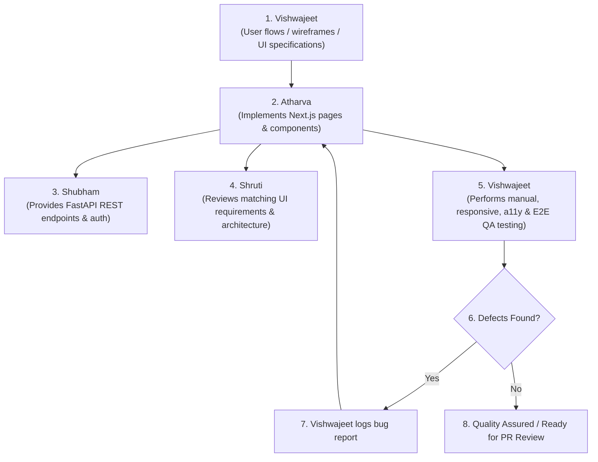
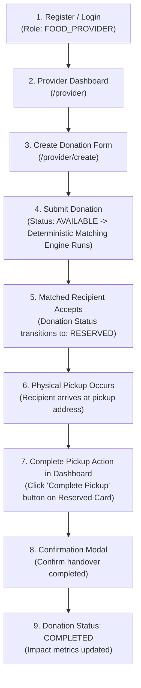
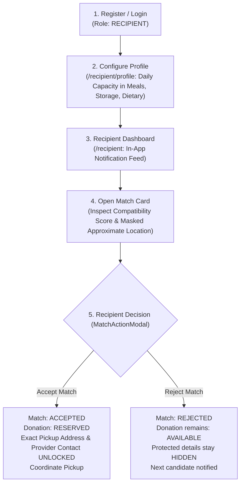
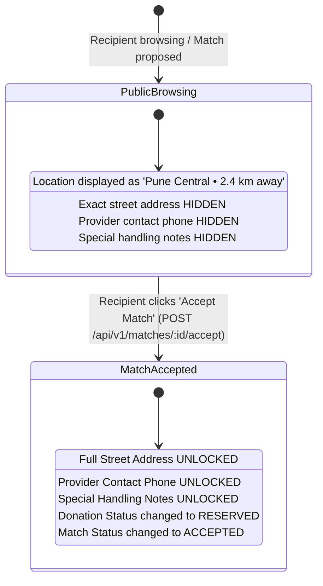

# UI & UX Guidelines — FoodSync AI

> **Status**: Architecture Frozen — Single Source of Truth for Frontend Architecture & UI/UX Design  
> **Frontend Stack**: Next.js 14+ (App Router) + TypeScript + Tailwind CSS  
> **UI/UX Design, Specifications & QA Owner**: Vishwajeet (`feature/ui-testing`)  
> **Frontend Implementation Owner**: Atharva (`feature/frontend`)  
> **Backend Integration Lead**: Shubham (`feature/backend`)  
> **AI Matching & System Architecture Lead**: Shruti (`feature/ai-matching`)  
> **Repository**: [KShruti772/FoodSync-AI](https://github.com/KShruti772/FoodSync-AI)

---

## 🌟 Team Ownership & Role Distinctions

| Teammate | Role | Working Branch | Primary Responsibilities |
| :--- | :--- | :--- | :--- |
| **Shruti** | **Team Lead / AI / Architecture** | `feature/ai-matching` | Deterministic matching engine (`backend/app/services/matching/`), mathematical scoring logic, system architecture, and technical direction. |
| **Shubham** | **Backend Developer** | `feature/backend` | Production FastAPI backend, REST controllers (`/api/v1`), Pydantic schemas, auth/JWT, and backend domain services. |
| **Atharva** | **Frontend Developer** | `feature/frontend` | Production Next.js App Router implementation, React components, Tailwind CSS styling, client state, and API integration. |
| **Lokeshwari** | **Database Developer** | `feature/database` | PostgreSQL schema, SQLAlchemy 2.x models, repositories, and Alembic migrations. *(Frontend never connects directly to PostgreSQL).* |
| **Vishwajeet** | **UI/UX + Testing / QA Lead** | `feature/ui-testing` | UI/UX specifications, user flows, wireframes, accessibility reviews, component UI tests (`frontend/components/__tests__/`), backend tests (`backend/tests/`), and Playwright E2E tests (`tests/e2e/`). |

---

## 1. UI Engineering Invariants & Architectural Boundaries

### 1.1 Separation of Concerns: UI/UX Design vs. Frontend Implementation
To ensure clear team ownership and prevent operational overlap:
- **UI/UX Design & QA (Vishwajeet — `feature/ui-testing`)**:
  - **Primary Responsibilities**: User flows, wireframes, screen specifications, UX consistency, accessibility review (WCAG 2.1 AA), responsive-design review, test-case design, manual exploratory testing, component tests (`frontend/components/__tests__/`), backend tests (`backend/tests/`), and Playwright E2E browser journeys (`tests/e2e/`).
  - **Boundary**: Vishwajeet specifies what the user sees, feels, and experiences, and verifies implementation through QA. He does **not** write production frontend application code.
- **Frontend Implementation (Atharva — `feature/frontend`)**:
  - **Primary Responsibilities**: Implements the production web client in Next.js (App Router) with TypeScript and Tailwind CSS based on Vishwajeet's UI/UX specifications; builds pages and components; integrates backend REST APIs (`/api/v1`); manages client-side state and UI feedback states; implements responsive layouts; and resolves frontend bugs reported by Vishwajeet.

### 1.2 Team Collaboration Flow


### 1.3 Core Engineering Invariants
1. **Backend Authoritative Principle & Security Boundary**:
   - The frontend may conditionally render UI based on authenticated session information, user role, and backend-provided resource state, but these are UX behaviors only.
   - The backend remains the sole security authority and **MUST independently enforce authentication, authorization, RBAC, ownership, and protected state transitions for every API operation**.
   - Frontend masking is presentation behavior; **backend authorization is the actual security boundary**.
2. **API Contract Authority**:
   - All API endpoints referenced by the UI/UX specification **MUST be defined in `docs/API_CONTRACT.md` before frontend implementation**.
   - The UI/UX document must not invent, redefine, or silently assume backend API behavior.
3. **Location & Contact Privacy Rules in UI**:
   - **Before Authorized Match Acceptance**: The UI displays only approximate geographic location and distance (e.g. *"Pune Central • 2.4 km away"*). The exact street address, food provider contact phone, and private handling instructions are hidden.
   - **After Authorized Match Acceptance**: Once an authorized recipient explicitly clicks "Accept Match" and the backend transitions the donation to `RESERVED`, the UI renders the full pickup address, provider contact telephone, and handling notes in the active coordination view.
4. **Deterministic Matching Engine Presentation**:
   - The matching process is driven by the **Deterministic Matching Engine** ($w_{dist}=0.35, w_{urg}=0.30, w_{cap}=0.20, w_{req}=0.15$). It is a mathematical multi-factor heuristic ranking algorithm, not machine learning, an LLM, or AI prediction.
   - *Note*: These weights are MVP heuristic parameters and are not claims of scientifically validated optimal weights.
   - Conceptual flow: Donation submitted $\rightarrow$ Donation becomes `AVAILABLE` $\rightarrow$ Deterministic Matching Engine evaluates candidates $\rightarrow$ Candidates are filtered $\rightarrow$ Candidates are scored $\rightarrow$ Candidates are ranked $\rightarrow$ Matches are stored in PostgreSQL $\rightarrow$ Recipient in-app notification is generated.
5. **No Heavy External UI Component Libraries**:
   - The MVP uses clean, custom Tailwind CSS utility classes. Do not install heavy component frameworks (e.g. MUI, AntD, Chakra) to keep bundle sizes minimal.
6. **Mobile-First Responsive Design**:
   - All layouts must adapt fluidly from mobile devices ($375\text{px}+$ width) to desktop screens ($1440\text{px}+$ width).
7. **No Unspecified Navigation / No Admin UI in MVP**:
   - The UI strictly implements the Food Provider and Recipient portals as specified. No unverified `/admin` screens or speculative routes are added to the client. Administrator accounts are managed exclusively via backend CLI seed scripts.

---

## 2. Design System & Tailwind CSS Tokens

### 2.1 Color Palette (Tailwind CSS Mapping)

| Palette Role | Tailwind Class | Hex Equivalent | Usage |
| :--- | :--- | :--- | :--- |
| **Brand Primary** | `bg-emerald-500` / `text-emerald-500` | `#10B981` | Primary action buttons, active navigation, brand accents |
| **Brand Primary Hover** | `hover:bg-emerald-600` | `#059669` | Button hover and focus states |
| **Secondary Accent** | `bg-teal-600` / `text-teal-600` | `#0D9488` | Secondary action buttons, match score badges |
| **Background Light** | `bg-slate-50` | `#F8FAFC` | Main application page background |
| **Surface / Card** | `bg-white` | `#FFFFFF` | Card containers, modal overlays, form input backgrounds |
| **Main Text** | `text-slate-900` | `#0F172A` | Primary headlines, table data, form labels |
| **Muted Text** | `text-slate-500` | `#64748B` | Subheadings, timestamps, placeholder text |
| **Borders** | `border-slate-200` | `#E2E8F0` | Card borders, dividers, form input outlines |
| **Warning** | `bg-amber-500` / `text-amber-600` | `#F59E0B` | Expiring soon pills (< 2 hrs remaining), pending match status |
| **Danger / Error** | `bg-red-500` / `text-red-600` | `#EF4444` | Expired tags, cancel buttons, form error banners |
| **Success** | `bg-emerald-100 text-emerald-800` | `#D1FAE5` | Completed donation pills, verified organization badges |

---

### 2.2 Typography Scale
- **Font Family**: Standard sans-serif stack via Tailwind: `font-sans` (`Inter` with system fallbacks).
- **Scale**:
  - `Page Title (H1)`: `text-2xl font-bold md:text-3xl text-slate-900`
  - `Section Header (H2)`: `text-xl font-semibold text-slate-800`
  - `Card Header (H3)`: `text-lg font-medium text-slate-800`
  - `Body Text`: `text-sm font-normal text-slate-700`
  - `Small / Metadata`: `text-xs font-normal text-slate-500`

---

## 3. Frontend Architecture & Component Directory

Atharva implements all pages and modular components following the standard Next.js App Router structure:

```text
frontend/
├── app/                               # Next.js App Router (pages & layouts)
│   ├── layout.tsx                     # Root shell with navbar & notification polling
│   ├── page.tsx                       # Landing page with impact summary
│   ├── login/page.tsx                 # User authentication
│   ├── register/page.tsx              # Food Provider & Recipient registration
│   ├── provider/                      # Food Provider portal
│   │   ├── page.tsx                   # Active listings dashboard & pickup completion modal
│   │   └── create/page.tsx            # Donation creation form
│   └── recipient/                     # Recipient organization portal
│       ├── page.tsx                   # Match inbox & active reservations
│       └── profile/page.tsx           # Capacity & dietary settings
│
├── components/                        # Reusable modular UI components
│   ├── common/
│   │   ├── Button.tsx                 # Primary, Secondary, Outline, Danger variants
│   │   ├── InputField.tsx             # Text, Number, DateTime inputs with error labels
│   │   ├── SelectDropdown.tsx         # Accessible role & category selectors
│   │   ├── StatusBadge.tsx            # Color-coded pill tags (AVAILABLE, RESERVED, COMPLETED, EXPIRED, CANCELLED)
│   │   ├── Modal.tsx                  # Accessible dialog overlay for confirmations
│   │   ├── LoadingSkeleton.tsx        # Animated skeleton cards for loading state
│   │   └── EmptyState.tsx             # Illustrated fallback when lists have 0 items
│   ├── navigation/
│   │   ├── Navbar.tsx                 # Header bar with user profile & role indicators
│   │   └── Sidebar.tsx                # Responsive navigation menu
│   └── domain/
│       ├── DonationCard.tsx           # Summary card with masked address for public browsing
│       ├── MatchCard.tsx              # Recipient card showing match score & factor breakdown
│       ├── MatchActionModal.tsx       # Recipient Accept/Reject match dialogue
│       ├── ImpactWidget.tsx           # Stat cards for rescued meals and CO2 savings
│       └── NotificationBell.tsx       # REST-polling in-app notification dropdown
│
├── hooks/                             # React custom hooks (useAuth, useNotifications)
├── lib/                               # Tailwind utilities and formatters
├── services/                          # REST client fetch wrappers (calling FastAPI)
└── types/                             # TypeScript interfaces matching API contracts
```

---

## 4. Key User Journeys & State Lifecycles

### 4.1 Match Status vs. Donation Status Lifecycle Distinction

The UI strictly distinguishes between **Match Status** and **Donation Status**:

| Entity | Permitted Lifecycle States | State Transitions & Triggers |
| :--- | :--- | :--- |
| **Match Status** | `PROPOSED`, `ACCEPTED`, `REJECTED` | Initial state when engine pairs candidates: `PROPOSED`<br>When recipient clicks **"Accept Match"**: Match $\rightarrow$ `ACCEPTED`<br>When recipient clicks **"Decline"**: Match $\rightarrow$ `REJECTED` |
| **Donation Status** | `AVAILABLE`, `RESERVED`, `COMPLETED`, `EXPIRED`, `CANCELLED` | When listing is submitted: Donation $\rightarrow$ `AVAILABLE`<br>When match is accepted: Donation $\rightarrow$ `RESERVED`<br>When pickup is finalized: Donation $\rightarrow$ `COMPLETED`<br>When provider cancels: Donation $\rightarrow$ `CANCELLED`<br>When cutoff reached: Donation $\rightarrow$ `EXPIRED` |

> [!CAUTION]
> **NO `CLAIMED` STATE**: The term `CLAIMED` must not appear anywhere in UI text, status badges, test cases, or documentation. The state machine transitions strictly from `AVAILABLE` $\rightarrow$ `RESERVED` $\rightarrow$ `COMPLETED`.

- **Notification Distinction**: In-app notifications are a separate communication entity (`notifications` table). Generating an in-app alert does not introduce additional custom statuses to the core `Match` entity.

---

### 4.2 Food Provider Flow & In-Dashboard Completion



- **In-Dashboard Pickup Completion**: The Food Provider completes pickups directly from the **Provider Dashboard** (`/provider`) via the `Complete Pickup` action on the active reserved listing card. No separate standalone page is required for completion.

---

### 4.3 Recipient Organization Flow



---

## 5. UI Privacy & Address Reveal Invariant



- **Before Authorized Match Acceptance**: The UI renders only approximate area and distance. Exact street address, provider telephone, and handling notes are omitted by the backend response.
- **After Authorized Match Acceptance**: When the backend validates authorization and transitions the donation to `RESERVED`, the full pickup address and provider contact information are unlocked exclusively in the active reservation view.

---

## 6. Standardized UI States & Feedback Rules

Every screen and data-fetching component built by Atharva must handle the 6 standard UI states:

| UI State | Visual Representation | Implementation Invariant |
| :--- | :--- | :--- |
| **1. Loading State** | `LoadingSkeleton` placeholder cards with pulse animation (`animate-pulse`). | Never render a blank screen or raw spinner during API fetch. |
| **2. Empty State** | `EmptyState` component with a clear icon, explanatory text, and Call-to-Action. | e.g. *"No active donations found in your radius. We will notify you when surplus is posted."* |
| **3. Error State** | Alert container in red (`bg-red-50 text-red-700 border-red-200`) with a "Retry" button. | Display user-friendly error messages; never display raw HTTP tracebacks. |
| **4. Success State** | Clean rendered cards/tables with clear typography and color-coded `StatusBadge`. | Provide toast alerts on state mutations (e.g. *"Match accepted! Pickup reserved."*). |
| **5. Disabled State** | Buttons and controls styled with `disabled:opacity-50 disabled:cursor-not-allowed`. | Disable submit buttons during active network requests and when form validation fails. |
| **6. Unauthorized State** | Clear permission warning banner or automated redirection to `/login`. | Gracefully inform users when access is denied or role permissions are insufficient. |

---

## 7. Accessibility (a11y) Standards

- **Semantic HTML**: Use `<header>`, `<nav>`, `<main>`, `<section>`, `<article>`, `<button>`, `<dialog>` appropriately.
- **Form Controls**: Every input element must have an associated `<label>` or explicit `aria-label`.
- **Color Contrast**: All text must satisfy WCAG 2.1 AA minimum contrast ratios ($4.5:1$ for body text against backgrounds).
- **Keyboard Navigation**: All interactive components (modals, dropdowns, buttons) must support focus outlines (`focus:ring-2 focus:ring-emerald-500`) and standard `Tab`, `Enter`, and `Escape` keyboard triggers.

---

## 8. Impact Metrics & Landing Page Summary

The public landing page (`frontend/app/page.tsx`) and user dashboards display key platform impact statistics fetched directly from the backend API (`GET /api/v1/impact/summary`):
- **Rescued Meals Counter** (`total_meals_rescued`): Total aggregate meals saved from waste.
- **$\text{CO}_2$ Emissions Prevented** (`total_co2_offset_kg`): Estimated carbon savings equivalent.
- **Active Participants** (`active_providers_count`, `active_recipients_count`): Total verified organizations participating.

> [!NOTE]
> **Impact Metrics Contract Alignment**:
> The UI displays backend-provided values from `GET /api/v1/impact/summary`. The frontend does **not** define its own calculation formulas. Any future extended analytics or category breakdowns must first be defined in `docs/API_CONTRACT.md` before frontend implementation.

---

## 9. UI/UX Quality Assurance & Testing Checklist (Vishwajeet)

Vishwajeet conducts manual, visual, accessibility, and E2E regression testing against Atharva's frontend implementation:

- [ ] **Loading State Verification**: Ensure skeleton loaders render smoothly without UI layout shifts during data fetching.
- [ ] **Empty State Verification**: Verify informative messages and CTAs appear when lists (donations, matches, notifications) contain zero items.
- [ ] **Error State Verification**: Confirm API error responses (400, 401, 403, 404, 409, 422, 500) trigger user-friendly error banners with retry mechanisms.
- [ ] **Success State Verification**: Validate visual confirmation badges, status updates, and feedback toasts upon action completion.
- [ ] **Disabled State Verification**: Verify action buttons disable immediately upon submission to prevent duplicate network calls.
- [ ] **Unauthorized State Verification**: Ensure unauthenticated or unauthorized role attempts are blocked with clear feedback.
- [ ] **Responsive Layouts**: Test fluidity across mobile ($375\text{px}$), tablet ($768\text{px}$), and desktop ($1440\text{px}$) viewports.
- [ ] **Accessibility (a11y) Review**: Verify keyboard navigation (`Tab`/`Enter`/`Esc`), screen reader labels, and contrast compliance.
- [ ] **Form Validation**: Test client-side and server-side validation on required inputs, meal quantity bounds ($>0$), and future expiry times.
- [ ] **Food Provider Flow**: Verify end-to-end provider journey: surplus creation, listing inspection, cancellation, and in-dashboard pickup completion.
- [ ] **Recipient Flow**: Test profile capacity configuration, incoming notification feed, and match inspection.
- [ ] **Accept / Reject Flow**: Test match acceptance (Match $\rightarrow$ `ACCEPTED`, Donation $\rightarrow$ `RESERVED`, address unlocked) and match rejection (Match $\rightarrow$ `REJECTED`, donation stays `AVAILABLE`).
- [ ] **Notification Flow**: Verify REST polling, unread alert counters, notification dropdown rendering, and mark-as-read behavior.

---

## 10. Architectural Status

> [!IMPORTANT]
> **Architecture is frozen; no blocking architectural decisions remain.**
